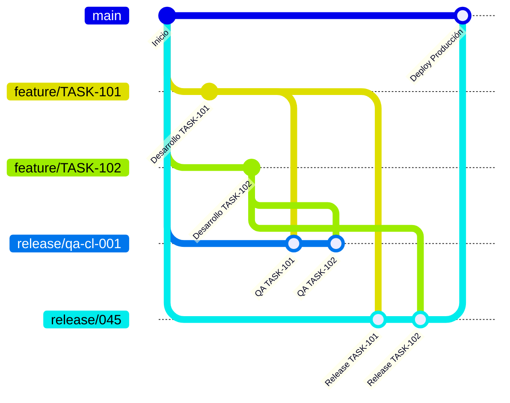

# Branching Strategy

> Modelo genérico del framework. Los **pases a producción con ticket CDA** siguen el flujo de ramas declarado por cada proyecto en su `doc/IA/pase-produccion.md` (ver README, sección *Agente de Pases de Producción*), que tiene prioridad sobre este documento.



> El diagrama usa `main` como nombre ilustrativo de la rama principal. La rama principal real **no siempre se llama `main`** — se define por repositorio (ver "Reglas del modelo" abajo).

## Reglas del modelo

- Las ramas `feature/<TASK-Número>-<slug-descriptivo>` no nacen siempre de `main`: nacen de la **rama principal del repositorio**, que se obtiene del `.code-workspace` indicado para el proyecto en [`docs/readme/proyectos.md`](../readme/proyectos.md) (fila "Workspace") — cada repositorio declarado ahí indica su propia rama principal en el atributo `principal-branch` (un mismo proyecto puede tener repos con ramas principales distintas, ej. frontend y backend). Ver también `specs/naming-conventions.md` para el formato del nombre de la rama.
- Toda feature debe integrarse primero en una rama `release/qa-<país>-<correlativo>` para su validación de QA (`<país>` se obtiene de la fila "País" del proyecto — ver sección "Ramas `release/qa-<país>-<correlativo>`" abajo).
- La rama `release/<correlativo>` se crea desde la rama principal del repositorio (mismo criterio que el primer punto) para preparar una liberación a producción.
- Solo las features que ya pasaron QA y fueron aprobadas manualmente hacen PR hacia la rama de release de producción.
- La única rama que puede hacer PR hacia la rama principal del repositorio es `release/<correlativo>` (o `hotfix/*`, ver más abajo) — nunca una `feature/*` ni una `release/qa-*` directamente.

Este modelo separa claramente el ciclo desarrollo → QA → release → producción, permitiendo validar varias features en paralelo por país antes de decidir cuáles se liberan juntas.

## Ramas `release/qa-<país>-<correlativo>`

- `<país>`: se obtiene de la fila "País" del proyecto correspondiente en [`docs/readme/proyectos.md`](../readme/proyectos.md), en minúsculas (ej. `País: MX` → `mx`) — código ISO 3166-1 alpha-2 (ej. `cl`, `pe`, `mx`), para funcionalidades cuyo comportamiento varía por país (ej. facturación electrónica). Nunca inventar o asumir el código: si la fila "País" no está completa para el proyecto, preguntar al usuario antes de nombrar la rama.
- `<correlativo>`: número secuencial de 3 dígitos, único por país, asignado por el `tech-lead` al abrir un nuevo ciclo de QA para ese país.
- Cada ciclo de QA usa una rama nueva — no se reutiliza entre ciclos. Se elimina una vez que sus features fueron promovidas a una rama `release/<correlativo>` (o descartadas).
- La validación de QA se ejecuta sobre esta rama (manual), no sobre `feature/*` de forma aislada, para detectar conflictos entre features que se liberarán juntas.

## Ramas `release/<correlativo>`

- `<correlativo>`: número secuencial de release, asignado manualmente al iniciar el flujo de `/release`.
- Solo reciben merge de `feature/*` que ya tienen PASS de QA (en su `release/qa-<país>-<correlativo>` correspondiente) y aprobación manual.
- Es la única rama (junto con `hotfix/*`) autorizada a abrir PR hacia la rama principal del repositorio.

## Convención de Commits

Conventional Commits, referenciando siempre el Task de origen:

```text
<tipo>(<TASK-Número>): <descripción en imperativo>
```

Tipos permitidos: `feat`, `fix`, `docs`, `style`, `refactor`, `perf`, `test`, `chore`.

Ejemplo: `feat(TASK-431): agregar validación de RUT`.

## Reglas de Pull Request

- **`feature/*` → `release/qa-<país>-<correlativo>`**: abierto por el `developer` al completar código + tests. Requiere que la suite de tests pase.
- **`feature/*` → `release/<correlativo>`**: requiere PASS de QA sobre la rama de QA correspondiente y aprobación manual explícita. Sin ambos, el PR no puede abrirse.
- **`release/<correlativo>` → rama principal**: requiere que todas las features incluidas cumplan la Definition of Done (ver [`docs/readme/definition-of-done.md`](../readme/definition-of-done.md)).
- Ningún agente aprueba ni mergea su propio PR: `developer` implementa; la validación y aprobación son manuales.

## Política de Merge

- `feature/*` → `release/qa-*`: **squash merge** (mantiene limpio el historial de iteración durante QA).
- `release/*` → rama principal: **merge commit** (preserva trazabilidad de qué features/Tasks se incluyeron en cada release).
- Las ramas `feature/*` y `release/qa-*` se eliminan una vez mergeadas; las ramas `release/<correlativo>` se conservan como referencia histórica del release.

## Hotfix

Para bugs críticos detectados en producción, fuera del ciclo normal de release:

1. Crear `hotfix/<TASK-Número>-<slug-descriptivo>` directamente desde la rama principal del repositorio (ver "Reglas del modelo").
2. El `developer` implementa el fix con su test de regresión correspondiente.
3. Se valida el fix de forma expedita y manual (sin pasar por `release/qa-<país>-<correlativo>`, dado el carácter urgente).
4. Se aprueba manualmente el PR `hotfix/*` → rama principal.
5. Se registra manualmente el hotfix en el changelog y se etiqueta el release correspondiente.
