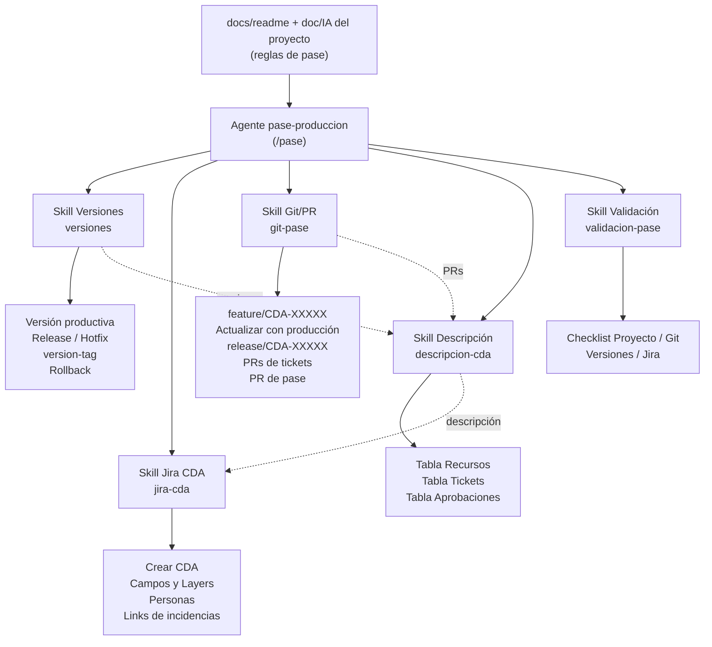

# Agente de Pases de Producción

El agente `pase-produccion` (vía **`/pase`**) automatiza un pase a producción gestionado con un ticket **CDA** de Jira ([proyecto CDA, board 108](https://grupoavla.atlassian.net/jira/software/c/projects/CDA/boards/108)): crea el CDA, las ramas `feature/CDA-XXXXX` y `release/CDA-XXXXX`, aplica las versiones, abre los PRs de integración y de pase, arma la descripción y valida todo. Es un flujo independiente del pipeline principal, como Soporte.

El agente **solo orquesta**. La lógica vive en skills (`.claude/skills/`) y las reglas de cada proyecto en su propia documentación:



## Flujo del Agente de Pases

```mermaid
flowchart TD

A[Inicio] --> B[Identificar proyecto]
B --> C["Leer docs/readme<br/>(índice en README.md)"]
C --> D[Leer doc/IA]
D --> E[Obtener reglas específicas]
E --> MO{"¿El usuario indicó<br/>un CDA existente?"}
MO -- Sí --> LE["Leer CDA existente y precargar datos<br/>(Skill Jira CDA)"]
MO -- No --> F
LE --> F{¿Información completa?}
F -- No --> G[Preguntar información faltante]
G --> F
F -- Sí --> H["Analizar tickets AMPMX/SPDI<br/>(Skill Jira CDA)"]
H --> I["Obtener Devs / QAs / ramas / PRs<br/>(Skill Git/PR)"]
I --> J{"¿Usuario elige Layers<br/>y aprueba el plan?<br/>(Skill Jira CDA)"}
J -- No --> G
J -- Sí --> ME{¿Modo editar?}
ME -- No --> K["Crear CDA en Jira<br/>(Skill Jira CDA)"]
ME -- Sí --> M
K --> L[Obtener CDA-XXXXX]
L --> M["Crear o reutilizar feature/CDA-XXXXX<br/>(Skill Git/PR)"]
M --> N["Actualizar branch con producción<br/>(Skill Git/PR)"]
N --> RL{"¿Permiso para crear<br/>release/CDA-XXXXX?<br/>(Skill Git/PR)"}
RL -- Sí --> RC["Crear o reutilizar release/CDA-XXXXX<br/>desde la rama productiva"]
RL -- No --> RM["Avisar al usuario: la persona correspondiente<br/>crea la rama release y el PR de pase a mano"]
RC --> O{"¿Repositorio maneja versión?<br/>(Skill Versiones)"}
RM --> O
O -- No --> P["Usar - en Versión y Rollback"]
O -- Sí --> Q[Obtener versión actual]
Q --> S{¿Release o Hotfix?}
S -- Release --> T["X.Y.Z → X.(Y+1).0"]
S -- Hotfix --> U["X.Y.Z → X.Y.(Z+1)"]
T --> V[Ejecutar version-tag]
U --> V
P --> W["Crear PRs de tickets<br/>(Skill Git/PR)"]
V --> W
W --> X["Construir descripción<br/>(Skill Descripción)"]
X --> Y["Configurar campos Jira<br/>(Skill Jira CDA)"]
Y --> VA["Vincular actividad:<br/>tickets del usuario ↔ CDA<br/>(Skill Jira CDA)"]
VA --> Z["PR feature/CDA → release/CDA<br/>y PR de pase release/CDA → productiva<br/>(Skill Git/PR)"]
Z --> V1["Validar Jira<br/>(Skill Validación)"]
V1 --> V2[Validar Git]
V2 --> V3[Validar versiones]
V3 --> V4[Validar descripción]
V4 --> V5{¿Todo validado?}
V5 -- Sí --> RF[Resumen final]
V5 -- No --> ER["Detener e informar:<br/>operación, falla, causa<br/>y qué falta para continuar"]
RF --> FIN[Fin]

K -. falla .-> ER
M -. falla .-> ER
V -. falla .-> ER
W -. falla .-> ER
Z -. falla .-> ER
```



> **Modo editar:** si al pedir el pase se menciona un CDA existente (ej. `/pase editar CDA-15600 ...`), el agente trabaja sobre ese ticket y nunca crea otro. Toma sus datos como base, pide solo la información que falte y reutiliza las ramas, versiones y PRs que ya existan. En los dos modos, cada ticket que comparta el usuario se vincula al CDA ("Vincular actividad").
>
> **Rama release:** el PR de pase sale siempre de `release/CDA-XXXXX` hacia la rama productiva (`master`/`main` o la que declare el proyecto), y la Tabla 1 del CDA muestra esa rama y ese PR. El agente intenta crear la release desde la rama productiva. Si el remoto lo rechaza por falta de permiso, avisa al usuario para que la persona correspondiente cree la rama y el PR de pase a mano. Después verifica la URL que le pasen o deja el PR como `pendiente (manual)`.
>
> El agente se detiene y pregunta (nunca inventa) cuando falta información, para elegir los **Layers** (siempre los elige el usuario entre las opciones de Jira) y para aprobar el plan antes de escribir en Jira o Git. No mergea ni aprueba PRs.

## Prioridad de reglas

```text
1. Instrucciones explícitas del usuario
        ↓
2. Documentación del proyecto (docs/readme / doc/IA)
        ↓
3. Skills (.claude/skills/) y formato general del CDA (specs/templates/cda-template.md)
        ↓
4. Reglas generales del agente
        ↓
5. Ejemplo CDA-14643 (solo referencia de formato, no se consulta en ejecución)
```

## Formato general del CDA

La **estructura** del ticket CDA es general y vive en ai-project: [`specs/templates/cda-template.md`](../../specs/templates/cda-template.md), tomada de CDA-14643. Incluye el resumen, los campos habituales y las 3 tablas de la descripción (Recursos, Tickets, Aprobaciones). Los **valores** son responsabilidad de cada proyecto: opciones predefinidas de selección, defaults y datos que se autocompletan (nombres de recursos, links de Deploy, personas), además de las ramas y el versionado.

Si el proyecto no define un valor, el agente se lo pregunta al usuario **de a una pregunta por vez** y espera la respuesta antes de hacer la siguiente. En los campos de selección muestra las opciones reales de Jira.

## Reglas de Pase por Proyecto

Cada proyecto declara sus reglas de pase (recursos, ramas productivas, flujo de ramas, versionado, valores de los campos de Jira, defaults, links de Deploy y, si los necesita, ajustes al formato general) en un archivo dentro de su `doc/IA/`. Si un proyecto no tiene archivo, el agente usa el formato general y pregunta de a uno todos los valores que hagan falta. El archivo es el catálogo de recursos del proyecto: cada pase incluye solo los repos que tengan cambios (puede ser uno solo, ej. solo front), y el agente no lee ni modifica los repos que no estén incluidos.

| Proyecto | Reglas de pase |
| --- | --- |
| Artico México | `doc/IA/pase-produccion.md` del repo `api-artico` |
| Canales Onboarding GT USA | — (sin definir: formato general + preguntas de a una) |
| Onboarding P&C México | — (sin definir: formato general + preguntas de a una) |

Para no tener que responder las mismas preguntas en cada pase, crear el `doc/IA/pase-produccion.md` del proyecto tomando como base el de Artico México, con los valores propios (ramas, repos sin versión, campos, deploy), y registrarlo en esta tabla. No hace falta tocar el agente ni las skills.
