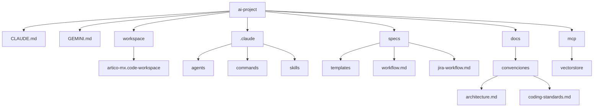

# Arquitectura del Proyecto

```text
CLAUDE.md
GEMINI.md
README.md
.mcp.json
mcp-postgres.config.json

.claude/
    agents/
    commands/
    skills/
    settings.json

specs/
    templates/      # incluye cda-template.md (formato general del CDA)
    workflow.md
    jira-workflow.md
    naming-conventions.md

workspace/
    artico-mx.code-workspace       # versionado — el resto de workspace/ (repos clonados) no
    canales-onboarding-gt-usa.code-workspace
    onboarding-pandc-mx.code-workspace

docs/
    guide.md
    readme/
        (secciones del índice de README.md)
    integraciones/
        database-access.md
    convenciones/
        architecture.md
        coding-standards.md
        api-guidelines.md
        branching-strategy.md
        glossary.md

mcp/
    vectorstore/      # server MCP de búsqueda semántica de entregables
```


