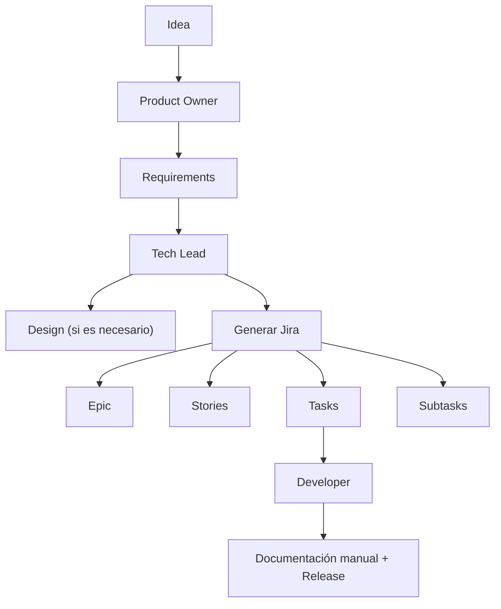
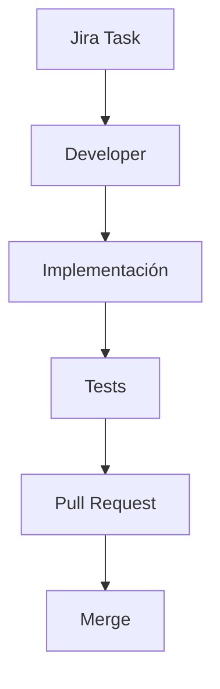
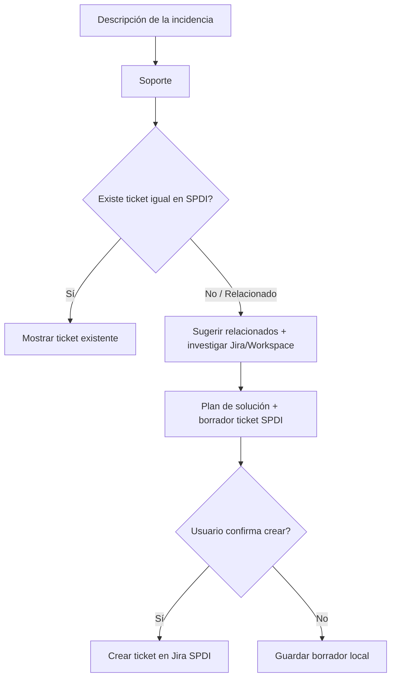

# Flujo de los Agentes

## Flujo del Developer

## Flujo de Soporte

> Flujo independiente y paralelo al pipeline principal (Idea→Release): se invoca vía `/soporte` en cualquier momento, sin depender de las etapas de Requirements/Design/Implementation.

## Agente de Pases de Producción

Flujo independiente (vía `/pase`), documentado con sus diagramas en [`docs/readme/agente-de-pases-de-produccion.md`](./agente-de-pases-de-produccion.md).
