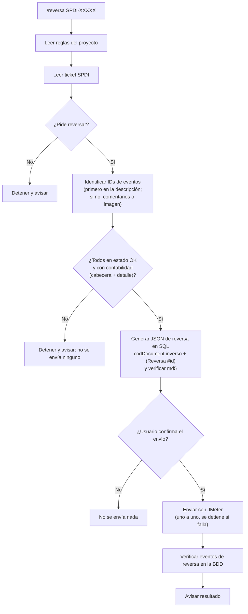

# Agente de Reversa de Movimientos

El agente `reversa-movimientos` (vía **`/reversa SPDI-XXXXX`**) reversa en producción los movimientos contables que pide un ticket de Jira Soporte (`SPDI`). Para cada evento original reenvía su `va_input` con el documento invertido, usando el script JMeter del proyecto, y después verifica en la BDD que la reversa se procesó. Es un flujo independiente del pipeline principal, como Soporte.

El agente **nunca escribe directamente en la BDD** y **nunca envía sin la confirmación explícita del usuario**.



## Reglas por Proyecto

### Kamui México

| Regla | Valor |
| --- | --- |
| Proyecto | Kamui México (ver [`proyectos.md`](../../readme/proyectos.md)) |
| Ticket | Jira Soporte `SPDI` |
| BDD | Conexión `kamui-prod` del MCP `postgres` (base `kamui_prod`, schema `public`) |
| País | `va_country = 'MX'` (la base es compartida por varios países: filtrar **siempre**) |
| Tabla de eventos | `events` (`nmsec_id_event`, `state_id`, `va_input`) |
| Estado requerido del original | `245` = `FINISHED` (autómata 10, MX billing). `246` = `FINISHED_WITH_ERRORS` |
| Contabilidad requerida | `tfa_accountancies_mx` (por `nmsec_id_event`) **y** `tfa_accountancy_details_mx` (por `nmsec_accountancy_id`) |
| Cambios en el `va_input` | `codDocument` (inverso) y `detail` (+ ` (Reversa #<id>)` al final). Además `dateBill` y `dateEmision` si el original es de otro mes (ver fila siguiente) |
| Fechas `dateBill` / `dateEmision` | Si el original es **del mismo mes** que la fecha de envío, se dejan como están. Si es **de otro mes**, hay que preguntar al usuario qué fecha llevan esos dos campos y no enviar sin su respuesta. El cambio se hace en SQL, igual que el de `codDocument`, con exactamente una ocurrencia de cada campo |
| Facturas / NC / ND | `tfa_bills_mx` (por `nmsec_id_event`). Este agente no reversa los eventos que generaron factura, nota de crédito o nota de débito. El comentario final del ticket indica que los tiene que reversar **el equipo de contabilidad** y, siempre, el folio de cada factura (`va_cod_dte_supplier`) (query 5) |

#### Mapeo de `codDocument`

| Original | Reversa |
| --- | --- |
| `B` (33) | `NC` (61) |
| `ND` (56) | `NC` (61) |
| `NC` (61) | `ND` (56) |

Cualquier otro valor: detenerse y preguntar.

#### Queries

**1. Estado y contabilidad de cabecera** (`tfa_accountancies_mx` no tiene índice por `nmsec_id_event`, pero responde en segundos):

```sql
select e.nmsec_id_event, e.state_id, s.name estado,
       (select count(*) from tfa_accountancies_mx a where a.nmsec_id_event = e.nmsec_id_event) accountancies
from events e join state_entity s using (state_id)
where e.va_country = 'MX' and e.nmsec_id_event = any(array[<ids>]::bigint[])
order by 1;
```

**2. Contabilidad de detalle.** `tfa_accountancy_details_mx` (unos 12 millones de filas) no tiene índice por `nmsec_accountancy_id`, y unir las tres tablas de una vez supera el timeout. Primero obtener los `nmsec_accountancy_id` de la query 1 y acotar por su rango:

```sql
select a.nmsec_id_event, count(*) details
from tfa_accountancy_details_mx d
join tfa_accountancies_mx a on a.nmsec_accountancy_id = d.nmsec_accountancy_id
where d.nmsec_accountancy_id between <min_accountancy_id> and <max_accountancy_id>
  and a.nmsec_id_event = any(array[<ids>]::bigint[])
group by 1;
```

**3. JSON de reversa.** Devuelve el `body` final en **una sola línea** (formato del CSV de JMeter) y su md5. `n_cod` y `n_detail` deben ser `1`, y `una_linea` y `sin_tilde` deben ser `true`; si no, detenerse. El patrón `"detail" : "` no coincide con el `\"detail\"` escapado que pueda haber dentro de `extraData`. Pasar a una línea solo quita los saltos de línea y la sangría entre campos: `extraData` lleva sus `\n` escapados y no cambia.

```sql
with ev as (
  select nmsec_id_event, state_id, va_input,
    (select count(*) from regexp_matches(va_input, '"codDocument" : "', 'g')) n_cod,
    (select count(*) from regexp_matches(va_input, '"detail" : "', 'g')) n_detail,
    substring(va_input from '"codDocument" : "([A-Z]+)"') cod_original
  from events where va_country = 'MX' and nmsec_id_event = any(array[<ids>]::bigint[])
), rev as (
  select *, case cod_original when 'B' then 'NC' when 'ND' then 'NC' when 'NC' then 'ND' end cod_nuevo from ev
), out as (
  select *, regexp_replace(regexp_replace(regexp_replace(va_input,
      '"codDocument" : "[A-Z]+"', '"codDocument" : "' || cod_nuevo || '"'),
      '("detail" : "[^"]*)"', '\1 (Reversa #' || nmsec_id_event || ')"'),
      E'\\r?\\n\\s*', '', 'g') body
  from rev
)
select nmsec_id_event, n_cod, n_detail, cod_original, cod_nuevo,
       position(E'\n' in body) = 0 una_linea, position('~' in body) = 0 sin_tilde,
       md5(body) md5, body
from out order by 1;
```

Cada `body` se guarda en `.cache/reversas/<SPDI-XXXXX>/<id>.json` (sin salto de línea final) y se comprueba que `md5sum` del archivo coincide con `md5` de la query. Sin esa coincidencia no se envía.

**4. Verificación después del envío:** buscar el evento de reversa por el texto que se añadió al `detail` (usa el índice trigram `events_idx4_mx`). El evento nuevo tiene que llegar a `245` y tener contabilidad (queries 1 y 2 con el ID nuevo).

```sql
select nmsec_id_event, state_id, ts_reception::text
from events
where va_country = 'MX' and lower(va_input) like lower('%(Reversa #<id>)%');
```

**5. Eventos con factura, NC o ND.** Sirve para el comentario final del ticket. Sobre los eventos de la póliza-endoso del ticket, revisados o descartados, devuelve los que tienen documentos en `tfa_bills_mx`:

```sql
select b.nmsec_id_event, b.nm_cod_document, b.va_cod_dte_supplier folio, b.va_policy, b.nm_endorsement, b.nmsec_bill_id
from tfa_bills_mx b
where b.nmsec_id_event = any(array[<ids>]::bigint[])
  and coalesce(b.bo_is_deleted, false) = false
order by 1;
```

#### JMeter

Todo vive dentro del proyecto, en `jmeter/`. En git solo están los scripts y los CSV de `jmeter/kamui-mx/`. JMeter y el JDK no se versionan: cada persona los instala en su máquina.

##### Instalación de JMeter y JDK

Una sola vez, desde la raíz del repo:

```bash
bash scripts/setup-jmeter.sh
```

El script descarga JMeter 5.4.3 (Apache) y el JDK 17.0.3+7 (Eclipse Temurin), comprueba su checksum y los descomprime en `jmeter/`. Si ya están instalados, no hace nada. Al final muestra la versión de Java y de JMeter. Funciona en Linux (glibc) y macOS, x86_64 y ARM. En Windows, solo dentro de WSL.

Si el script no puede instalarlos (por ejemplo, por un proxy o un SO no soportado), hay que hacerlo a mano:

1. Descargar JMeter 5.4.3 desde `https://archive.apache.org/dist/jmeter/binaries/apache-jmeter-5.4.3.tgz` y descomprimirlo en `jmeter/`.
2. Descargar el JDK 17 de Temurin para el SO desde `https://github.com/adoptium/temurin17-binaries/releases/tag/jdk-17.0.3%2B7` (archivo `OpenJDK17U-jdk_<arch>_<os>_hotspot_17.0.3_7.tar.gz`), descomprimirlo y renombrar la carpeta `jdk-17.0.3+7` a `jmeter/jdk-17`. En macOS, lo que va en `jmeter/jdk-17` es el contenido de `jdk-17.0.3+7/Contents/Home`.
3. Comprobar que funciona:
   ```bash
   jmeter/jdk-17/bin/java -version
   JAVA_HOME=$PWD/jmeter/jdk-17 jmeter/apache-jmeter-5.4.3/bin/jmeter --version
   ```

Con cualquiera de las dos formas, `jmeter/` tiene que quedar así:

```
jmeter/
├── apache-jmeter-5.4.3/      ← instalado (no versionado)
│   └── bin/jmeter
├── jdk-17/                   ← instalado (no versionado)
│   └── bin/java
└── kamui-mx/                 ← versionado
    ├── SendEvents.jmx
    ├── sendEvents.csv
    ├── ForceEvents.jmx
    └── idEvent.csv
```

##### Parámetros

| Parámetro | Valor |
| --- | --- |
| Java | `jmeter/jdk-17` |
| JMeter | `jmeter/apache-jmeter-5.4.3/bin/jmeter` |
| Script de envío | `jmeter/kamui-mx/SendEvents.jmx`, sampler "Eventos" (único habilitado): `POST ${ENV_PROD}/kamui/billing/test-billing?codCountry=MX&codEmpresa=MX` |
| Archivo de datos del envío | `jmeter/kamui-mx/sendEvents.csv` (ruta relativa al `.jmx`): cabecera `body`, delimitador `~`, un registro por línea |
| Script para forzar | `jmeter/kamui-mx/ForceEvents.jmx`, sampler "Force Events" (único habilitado): `GET ${ENV_PROD}/kamui/billing/force-billing/MX/${idEvent}?codEmpresa=MX`. Se usa siempre que, después del envío, un evento de reversa queda en `241` CREATED, sin preguntar al usuario. Se fuerza un evento a la vez |
| Archivo de datos para forzar | `jmeter/kamui-mx/idEvent.csv`: cabecera `idEvent`, un ID por línea |
| Token | Variable `token` de cada `.jmx` (Bearer). Caduca: si el envío da 401/403, hay que renovarlo en el `.jmx` |

No cambiar qué samplers están habilitados en los `.jmx`: para enviar se usa `SendEvents.jmx` y para forzar `ForceEvents.jmx`.

Que el force termine por timeout es normal y no cuenta como fallo. Lo que cuenta es el evento: falla solo si a los 3 minutos de forzarlo todavía no llegó a `245` con su contabilidad.

El hilo hace **una sola iteración**, así que envía solo la primera línea del CSV: un evento por ejecución.

Por cada evento, en orden:

1. Escribir el CSV con la cabecera y el `body` del evento:
   ```bash
   { printf 'body\n'; cat .cache/reversas/<SPDI-XXXXX>/<id>.json; printf '\n'; } > jmeter/kamui-mx/sendEvents.csv
   ```
2. Ejecutar JMeter en modo consola. Dentro del sandbox, la salida a internet pasa por su proxy: se toma de `HTTPS_PROXY` (host `127.0.0.1`, puerto `3128`, usuario y contraseña) y el dominio `nl2hg2x36l.execute-api.us-west-2.amazonaws.com` tiene que estar permitido.
   ```bash
   export JAVA_HOME=$PWD/jmeter/jdk-17 PATH=$PWD/jmeter/jdk-17/bin:$PATH
   U="${HTTPS_PROXY#*://}"; CRED="${U%@*}"
   jmeter/apache-jmeter-5.4.3/bin/jmeter -n -t jmeter/kamui-mx/SendEvents.jmx \
     -H 127.0.0.1 -P 3128 -u "${CRED%%:*}" -a "${CRED#*:}" \
     -Jjmeter.save.saveservice.output_format=csv \
     -l .cache/reversas/<SPDI-XXXXX>/<id>.jtl \
     -j .cache/reversas/<SPDI-XXXXX>/<id>.log
   ```
3. El envío es correcto si en el `.jtl` la columna `success` es `true` y `responseCode` es 2xx. Si no, el agente se detiene y no envía los siguientes.
